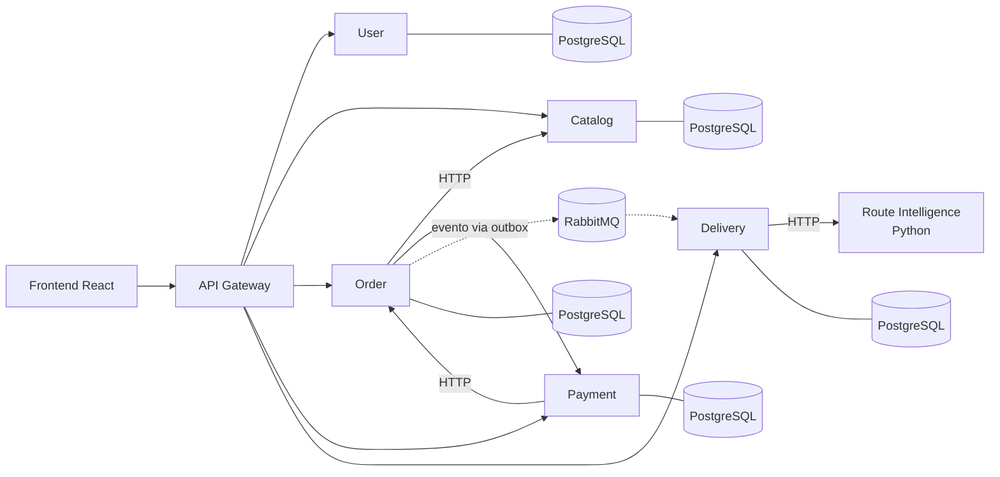
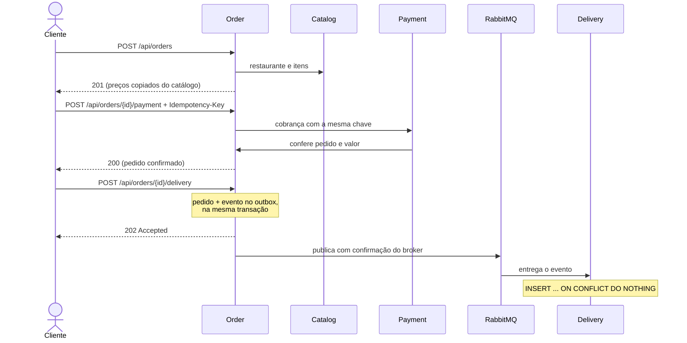

# delivery-ai

Sistema de pedidos para delivery feito com microsserviços em Java e Spring Boot, mais um serviço em Python que calcula a rota mais rápida com um modelo de machine learning.

O cliente cria uma conta, monta o pedido com os itens de um restaurante, paga e pede a entrega. Um operador conduz a entrega até o fim e calcula a rota. O pagamento, a cidade e o trânsito são simulados: o foco do projeto está na integração entre os serviços, e não no domínio de delivery.

## Arquitetura



| Serviço | O que faz | Porta |
| --- | --- | --- |
| API Gateway | Roteia as chamadas e cria o `X-Request-Id`. Não tem regra de negócio | 8080 |
| User | Cadastro, login, perfis e endereços. É o único que emite tokens JWT | 8081 |
| Catalog | Restaurantes, cardápio, preços e disponibilidade | 8082 |
| Order | Pedidos e totais; coordena pagamento e entrega | 8083 |
| Payment | Tentativas de pagamento simuladas, idempotentes por chave | 8084 |
| Delivery | Entregas, entregadores, ciclo da entrega e plano de rota | 8085 |
| Route Intelligence | Prevê o tempo de cada trecho e roda Dijkstra sobre um grafo sintético | 8000 |

Cada serviço Java tem seu próprio banco, build Maven e migrations, e nenhum lê a tabela de outro. Por dentro, todos seguem as mesmas camadas: `domain` (regras em Java puro), `application` (casos de uso e portas), `api` (controllers e DTOs) e `infrastructure` (JPA, clientes HTTP e mensageria).

## Do pedido à entrega



## Decisões principais

- **Outbox transacional.** O pedido de entrega e o evento são gravados na mesma transação, e um publicador agendado envia o evento ao RabbitMQ com *publisher confirms*. Se o broker cair, o evento espera no banco. [Detalhes](docs/delivery-messaging.md)
- **Consumidor idempotente, retry e DLQ.** A entrega é única por pedido, então uma mensagem repetida não cria outra entrega. Falhas passageiras têm 3 tentativas com backoff; mensagens inválidas vão direto para a fila de mensagens mortas.
- **Pagamento idempotente.** O Order grava a intenção antes de chamar o Payment, e o Payment usa a `Idempotency-Key` com constraints únicas. Repetir a chamada com a mesma chave nunca cobra duas vezes. [Detalhes](docs/order-payment-integration.md)
- **Concorrência otimista.** `@Version` em pedidos e entregas: uma escrita baseada em versão antiga recebe `409`.
- **JWT RS256.** Só o User tem a chave privada. Os outros serviços validam o token com a chave pública publicada em `/.well-known/jwks.json` (OAuth2 Resource Server). [Detalhes](docs/security-hardening.md)
- **Rastreio por `X-Request-Id`.** O id criado no Gateway passa por todos os serviços, inclusive pelo RabbitMQ, e aparece em cada linha de log. Métricas do outbox, do consumo e do roteamento ficam no Actuator. [Detalhes](docs/request-observability.md)
- **Rotas com ML.** Uma Random Forest (scikit-learn), treinada offline com dados sintéticos, prevê o tempo de cada trecho, e o Dijkstra escolhe o caminho. [Detalhes](docs/route-intelligence.md)

## Stack

Java 21, Spring Boot 4.1, Spring Cloud Gateway, Spring Data JPA, Spring Security, Spring AMQP, PostgreSQL 17, Flyway, RabbitMQ 4.1 · Python 3.12, FastAPI, scikit-learn · React 19, TypeScript, Vite · JUnit 5, AssertJ, Mockito, Testcontainers, pytest, Vitest, Playwright · Docker Compose, GitHub Actions

## Como rodar

Só é preciso Docker com Compose v2. No Linux, os scripts `.ps1` também pedem o PowerShell 7 (`pwsh`).

```bash
cp -n .env.example .env
scripts/initialize-auth-secret.sh                   # gera a chave RSA e a conta do operador
pwsh -NoProfile -File scripts/prepare-route-model.ps1   # treina o modelo de rotas (só na primeira vez)
docker compose --profile demo up -d --build --wait --wait-timeout 600
pwsh -NoProfile -File scripts/seed-demo-catalog.ps1     # restaurantes e cardápios de exemplo
```

<details>
<summary>No Windows (PowerShell)</summary>

```powershell
if (-not (Test-Path .env)) { Copy-Item .env.example .env }
powershell -NoProfile -ExecutionPolicy Bypass -File scripts/initialize-auth-secret.ps1
powershell -NoProfile -ExecutionPolicy Bypass -File scripts/prepare-route-model.ps1
docker compose --profile demo up -d --build --wait --wait-timeout 600
powershell -NoProfile -ExecutionPolicy Bypass -File scripts/seed-demo-catalog.ps1
```
</details>

Depois disso:

- Interface: http://localhost:3000
- Gateway: http://localhost:8080
- RabbitMQ (painel): http://localhost:15672, com as credenciais `RABBITMQ_*` do `.env`

Para operar as entregas, entre com `USER_OPERATOR_EMAIL` e `USER_OPERATOR_PASSWORD` do `.env` e abra **Operação**.

Sem `--profile demo`, o Compose sobe só os bancos e o RabbitMQ, para rodar os serviços pela IDE. Nesse caso, configure o diretório de trabalho como a raiz do repositório, para o Spring ler o `.env`. Os detalhes estão em [execução local](docs/catalog-postgresql.md).

## Testes

Cada serviço Java tem testes de domínio, de casos de uso, de persistência e de API. Os testes de banco e de mensageria sobem PostgreSQL e RabbitMQ reais com Testcontainers, então precisam do Docker.

```bash
./services/order-service/mvnw -f services/order-service/pom.xml verify
```

O CI ([`ci.yml`](.github/workflows/ci.yml)) roda os seis builds Java, o Python (ruff + pytest) e o frontend (lint + Vitest). Se tudo passar, ele sobe os 14 contêineres e roda:

- um smoke que derruba o RabbitMQ e o serviço Python no meio do fluxo e confere a recuperação ([`smoke-route-demo.ps1`](scripts/smoke-route-demo.ps1));
- os testes no navegador com Playwright ([`e2e/`](e2e)).

Veja a [validação da V1](docs/v1-release-validation.md).

## Estrutura

```text
api-gateway/                 Spring Cloud Gateway
services/
  user-service/              autenticação e perfis
  catalog-service/           restaurantes e cardápio
  order-service/             pedidos, outbox
  payment-service/           pagamentos simulados
  delivery-service/          entregas e rotas
  route-intelligence-service/  Python: modelo e Dijkstra
frontend/                    React + TypeScript
e2e/                         Playwright
scripts/                     .env, modelo, seed e smoke
docs/                        documentação por assunto
compose.yaml  Dockerfile.java
```

## Limites conhecidos

- Pagamento, ruas, trânsito e entregadores são simulados. A cidade tem 7 pontos, e um destino fora deles cria o pedido, mas fica sem rota.
- Só a solicitação de entrega é assíncrona. O status da entrega não volta ao pedido por evento, não existe estorno e a DLQ não é reprocessada automaticamente.
- Catálogo e perfis não têm controle de versão: a última gravação vence.
- O limite de tentativas de login fica em memória, por instância. Não há refresh token, e existe um único operador.
- É um ambiente local de demonstração: sem TLS, sem deploy e com credenciais no `.env`.

## Documentação

| Assunto | Documentos |
| --- | --- |
| Arquitetura | [visão geral](docs/architecture.md) · [roadmap](docs/roadmap.md) |
| Usuários e segurança | [perfis](docs/user-profiles.md) · [autenticação](docs/authentication.md) · [autorização](docs/resource-authorization.md) · [papéis e chaves](docs/security-hardening.md) |
| Catálogo | [PostgreSQL e execução](docs/catalog-postgresql.md) · [cardápio](docs/restaurant-menu.md) |
| Pedidos e pagamentos | [pedidos](docs/orders.md) · [itens e preços](docs/order-items.md) · [pagamentos simulados](docs/simulated-payments.md) · [pagamento do pedido](docs/order-payment-integration.md) |
| Entregas | [domínio](docs/delivery-domain.md) · [ciclo e API](docs/delivery-lifecycle.md) · [persistência](docs/delivery-persistence.md) · [mensageria](docs/delivery-messaging.md) · [pedido → entrega](docs/order-delivery-integration.md) · [rotas](docs/delivery-route-integration.md) |
| Route Intelligence | [visão geral](docs/route-intelligence.md) · [contrato Java ↔ Python](docs/route-intelligence-contract.md) · [API de rotas](docs/intelligent-routing-api.md) · [modelo](docs/route-segment-model.md) · [Compose](docs/route-intelligence-compose.md) |
| Frontend | [base](docs/frontend-foundation.md) · [checkout](docs/frontend-checkout.md) · [entregas](docs/frontend-deliveries.md) |
| Qualidade | [observabilidade](docs/request-observability.md) · [CI](docs/ci-validation.md) · [validação da V1](docs/v1-release-validation.md) |

## Licença

[MIT](LICENSE)
